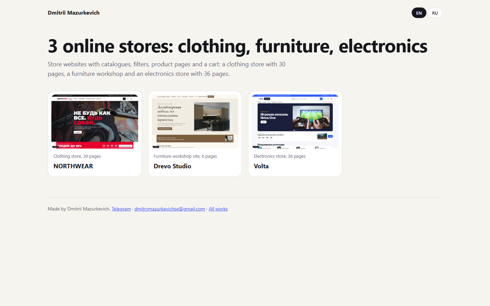

# 3 online stores: clothing, furniture, electronics

Store websites with catalogues, filters, product pages and a cart: a clothing store with 30 pages, a furniture workshop and an electronics store with 36 pages.

**Live:** https://dmitrii-mazurkevich.github.io/online-store-websites/

## Inside

- [NORTHWEAR](https://dmitrii-mazurkevich.github.io/online-store-websites/fashion/index.html): clothing store, 30 pages
- [Drevo Studio](https://dmitrii-mazurkevich.github.io/online-store-websites/furniture/index.html): furniture workshop site, 6 pages
- [Volta](https://dmitrii-mazurkevich.github.io/online-store-websites/electronics/index.html): electronics store, 36 pages

## Built with

HTML, CSS, JavaScript. Static site without a build step: open `index.html` or publish the folder to any hosting.
English and Russian versions with a language switcher, layout for phones and desktops.

## Author

Made by Dmitrii Mazurkevich: websites, WordPress and WooCommerce, analytics and AI automation.
Telegram https://t.me/dmitrii_pjm · dmitrymazurkevichse@gmail.com · [all works](https://github.com/dmitrii-mazurkevich)
